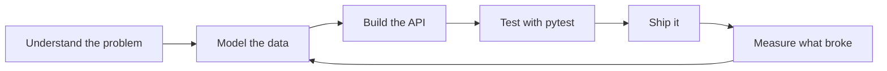

<picture>
  <source media="(prefers-color-scheme: dark)" srcset="./assets/profile-header-dark.svg">
  <source media="(prefers-color-scheme: light)" srcset="./assets/profile-header-light.svg">
  
</picture>

  <picture>
    <source media="(prefers-color-scheme: dark)" srcset="https://readme-typing-svg.demolab.com?font=JetBrains+Mono&amp;weight=700&amp;size=21&amp;pause=1400&amp;color=5EEAD4&amp;center=true&amp;vCenter=true&amp;width=780&amp;height=42&amp;lines=Backend+Python+Developer;AI+systems+%26+RAG;pytest+-q+%E2%86%92+green+every+time;learning+in+public%2C+building+out+loud">
    <source media="(prefers-color-scheme: light)" srcset="https://readme-typing-svg.demolab.com?font=JetBrains+Mono&amp;weight=700&amp;size=21&amp;pause=1400&amp;color=0D9488&amp;center=true&amp;vCenter=true&amp;width=780&amp;height=42&amp;lines=Backend+Python+Developer;AI+systems+%26+RAG;pytest+-q+%E2%86%92+green+every+time;learning+in+public%2C+building+out+loud">
    
  </picture>

  
  
  
  

  
  
  
  
  

I'm a CS undergrad from India who learns by shipping. Most of what I build is backend Python — REST APIs, data models, async workflows, and LLM pipelines — wrapped in a UI someone can actually use. Then I measure what broke and fix it.

---

## ⚡ Selected work

<table>
  <tr>
    <td width="50%" valign="top">
      <h3><a href="https://github.com/Aayush-shrma/daylog-v1">01 · DayLog</a> &nbsp;<a href="https://daylog-v1.vercel.app/"><kbd>live ↗</kbd></a></h3>
      
Paste the messy version of your day; get clean bullets and a ready-to-post tweet. 365-day heatmap, streaks, and bring-your-own-key AI that never leaves the browser.

      
<strong>148 tests green</strong> Multi-stage Docker · served same-origin with httpOnly sessions

           
    </td>
    <td width="50%" valign="top">
      <h3><a href="https://github.com/Aayush-shrma/AI-support-agent">02 · AI Support Agent</a></h3>
      
An LLM-powered support workflow for ticket classification, grounded reply drafting, and escalation to a human when the risk looks high.

      
<strong>92.1% intent accuracy</strong> 55.2% majority-class baseline · 6 intents

          
    </td>
  </tr>
  <tr>
    <td width="50%" valign="top">
      <h3><a href="https://github.com/Aayush-shrma/Second-brain">03 · Second Brain</a></h3>
      
A privacy-first desktop memory: it indexes your local files and makes them searchable in plain language. Everything runs on your machine.

      
<strong>10,000+ items indexed</strong> Vector + full-text search · local-first

          
    </td>
    <td width="50%" valign="top">
      <h3><a href="https://github.com/Aayush-shrma/Final_year_project">04 · Wanderlust 2.0</a> &nbsp;<a href="https://majorproject-mu-five.vercel.app"><kbd>live ↗</kbd></a></h3>
      
An accommodation and property-rental marketplace built end to end: listings with maps, image uploads, sessions, and review flows.

      
<strong>Full-stack, deployed</strong> Mapbox geocoding · Cloudinary media pipeline

          
    </td>
  </tr>
  <tr>
    <td width="50%" valign="top">
      <h3><a href="https://github.com/Aayush-shrma/valorstat">05 · Valorant Tracker</a></h3>
      
A stats tracker I built for me and my friends: match history, win-rate analytics, and player lookups.

      
<strong>Under 200 ms</strong> API response time in local benchmarks

         
    <td width="50%" valign="top">
      <h3><a href="https://github.com/search?q=author%3AAayush-shrma+is%3Apr+is%3Amerged&type=pullrequests">06 · Open source ↗</a></h3>
      
Contributing to real-world codebases through bug fixes, tests, and pull requests.

      
<strong>View all merged pull requests</strong> Across repositories · Automatically updated by GitHub

      
    </td>
  </tr>
</table>

---

## 🧠 What I focus on

- **Backend engineering** — REST APIs, asynchronous workflows, data modelling, and services that stay up.
- **AI systems** — LLM integration, RAG, embeddings, and retrieval evaluation that actually measures something.
- **Problem solving** — DSA practice, and learning by implementing, testing, and iterating until it holds.

  <picture>
    <source media="(prefers-color-scheme: dark)" srcset="https://skillicons.dev/icons?i=python,java,js,fastapi,django,flask,react,postgres,mongodb,sqlite,git,github,docker&amp;theme=dark">
    <source media="(prefers-color-scheme: light)" srcset="https://skillicons.dev/icons?i=python,java,js,fastapi,django,flask,react,postgres,mongodb,sqlite,git,github,docker&amp;theme=light">
    
  </picture>

<b>How I build — the loop I keep coming back to</b>

 

---

## 📊 GitHub in numbers

  <picture>
    <source media="(prefers-color-scheme: dark)" srcset="https://streak-stats.demolab.com?user=Aayush-shrma&amp;hide_border=true&amp;background=0B1020&amp;stroke=5EEAD4&amp;ring=60A5FA&amp;fire=A78BFA&amp;currStreakLabel=5EEAD4&amp;sideNums=C9D4E8&amp;sideLabels=8A99B8&amp;dates=8A99B8">
    <source media="(prefers-color-scheme: light)" srcset="https://streak-stats.demolab.com?user=Aayush-shrma&amp;hide_border=true&amp;background=FFFFFF&amp;stroke=0D9488&amp;ring=2563EB&amp;fire=7C3AED&amp;currStreakLabel=0D9488&amp;sideNums=243753&amp;sideLabels=536783&amp;dates=536783">
    
  </picture>

  <picture>
    <source media="(prefers-color-scheme: dark)" srcset="https://raw.githubusercontent.com/Aayush-shrma/Aayush-shrma/output/github-snake-dark.svg">
    <source media="(prefers-color-scheme: light)" srcset="https://raw.githubusercontent.com/Aayush-shrma/Aayush-shrma/output/github-snake.svg">
    
  </picture>

  Streak card and contribution snake are generated automatically — the snake is rebuilt nightly by <a href="https://github.com/Aayush-shrma/Aayush-shrma/blob/main/.github/workflows/snake.yml">this workflow</a>.

---

## 📬 Let's connect

  <a href="https://linkedin.com/in/aayush-sharma-11374b411"><b>LinkedIn</b></a> &nbsp;·&nbsp;
  <a href="https://leetcode.com/u/Aayush9139/"><b>LeetCode</b></a> &nbsp;·&nbsp;
  <a href="https://x.com/Aayush9139"><b>X</b></a> &nbsp;·&nbsp;
  <a href="https://github.com/Aayush-shrma?tab=repositories"><b>All repositories</b></a>

<a href="https://github.com/Aayush-shrma/Aayush-shrma/issues/new?template=guestbook.yml"><b>Sign the guestbook</b></a> — say hi, or tell me what you're building.

If you're building something backend- or retrieval-shaped, I'd like to hear about it — open an issue, or just say hi.

B.Tech Computer Science &amp; Engineering · Parul University · Expected 2027

<i>Build things. Measure results. Improve what doesn't work.</i>

MIT licensed · Last redesigned October 2026

