<picture>
  <source media="(prefers-color-scheme: dark)" srcset="./profile-header-dark.svg">
  <source media="(prefers-color-scheme: light)" srcset="./profile-header-light.svg">
  
</picture>

  <a href="https://github.com/Aayush-shrma">GitHub</a> &nbsp;·&nbsp;
  <a href="https://linkedin.com/in/aayush-sharma-11374b411">LinkedIn</a> &nbsp;·&nbsp;
  <a href="https://leetcode.com/u/Aayush9139/">LeetCode</a>

  

## Selected work

<table>
  <tr>
    <td width="50%" valign="top">
      <h3><a href="https://github.com/Aayush-shrma/AI-support-agent">01 / AI Support Agent ↗</a></h3>
      
An LLM-powered support workflow for ticket classification, grounded reply drafting, and escalation to a human when risk is high.

      
<strong>92.1% intent accuracy</strong> 55.2% majority-class baseline · 6 intents

      Python · Groq · ChromaDB · RAG
    </td>
    <td width="50%" valign="top">
      <h3><a href="https://github.com/Aayush-shrma/Second-brain">02 / Second Brain ↗</a></h3>
      
A privacy-first desktop memory app that makes local files and browser history searchable in natural language.

      
<strong>10,000+ items indexed</strong> Vector + full-text search · Local-first

      Python · FastAPI · React · SQLite · ChromaDB
    </td>
  </tr>
  <tr>
    <td width="50%" valign="top">
      <h3><a href="https://github.com/Aayush-shrma/valorstat">03 / Valorant tracker ↗</a></h3>
      
A full-stack tracker for player stats, match history, and win-rate analytics, built end-to-end.

      
<strong>Under 200 ms</strong> API response time in local benchmarks

      Python · Flask · MongoDB · JavaScript
    </td>
    <td width="50%" valign="top">
      <h3>04 / Open source</h3>
      
Learning in public through real codebases, issue-driven changes, tests, and pull-request reviews.

      
<strong><a href="https://github.com/scs0209/laya-guard/issues/51">Laya Guard · Issue #51 ↗</a></strong> Offline verdict logging and statistics

      Python · Pytest · GitHub
    </td>
  </tr>
</table>

## What I'm focused on

- **Backend engineering:** REST APIs, asynchronous workflows, data modelling, and reliable services.
- **AI systems:** LLM integration, RAG, embeddings, and retrieval evaluation.
- **Problem solving:** DSA practice and learning by implementing, testing, and iterating.

B.Tech Computer Science & Engineering · Parul University · Expected 2027

---

<i>Build things. Measure results. Improve what doesn't work.</i>

